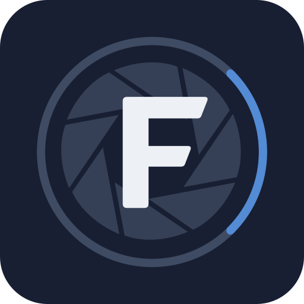

  

<h1 align="center">Focale Community</h1>

  Help shape Focale, a local-first image editor for Linux, Windows and macOS.

  <a href="https://github.com/focale-editor/community/issues/new/choose"><strong>Share feedback</strong></a>
  · <a href="https://github.com/focale-editor/community/issues">Browse issues</a>
  · <a href="https://focale-editor.app/docs">Documentation</a>
  · <a href="https://focale-editor.app/#downloads">Download Focale</a>

Welcome! This is the shared home for **bug reports, feature requests,
improvements and questions** about [Focale](https://focale-editor.app).
Whether you use the editor, explore the website or need help getting started,
your feedback helps make Focale better.

## Share your feedback

| Your needs                           | Choose                                                                                                   | Include                                                                     |
|--------------------------------------|----------------------------------------------------------------------------------------------------------|-----------------------------------------------------------------------------|
| Something is not working             | [Bug report](https://github.com/focale-editor/community/issues/new?template=01-bug-report.yml)           | What happened, steps to reproduce, expected result, version and environment |
| You need a new capability            | [Feature request](https://github.com/focale-editor/community/issues/new?template=02-feature-request.yml) | What you are trying to achieve and why it matters                           |
| An existing workflow could be better | [Improvement](https://github.com/focale-editor/community/issues/new?template=03-improvement.yml)         | The current friction and the change that would help                         |
| You have a question                  | [Question](https://github.com/focale-editor/community/issues/new?template=04-question.yml)               | Your goal, what you tried and where you got stuck                           |

Not sure which category fits? Choose the closest one; a maintainer can relabel
the issue. Feedback about documentation, downloads and installation belongs
here too.

## Before opening an issue

1. Search [open and closed issues](https://github.com/focale-editor/community/issues?q=is%3Aissue)
   for an existing report or idea. Add useful details or a 👍 reaction there.
2. Keep each issue focused on one problem or proposal, with a descriptive title.
3. For bugs, include the exact version and build number when available. Attach a
   small sample, screenshot or recording if it helps reproduce the problem.
4. Remove private images, personal information and credentials from attachments
   and logs. Issues and uploaded attachments are public.

See [CONTRIBUTING.md](CONTRIBUTING.md) for reporting tips. For a security
vulnerability, use the private contact in [SECURITY.md](SECURITY.md).

## What happens next?

New issues start with `needs-triage`. A maintainer reviews the report, asks for
details when needed and groups duplicates. Accepted work may be marked `planned`
or `in-progress`; these labels do not promise a release date. Fixes and delivered
features should link to the relevant release when available.

Useful reproductions, examples of real workflows and testing a fix all help.
Please keep conversations respectful and avoid posting repeated requests for
updates. Feedback is welcome even when a proposal cannot be implemented.

## Related projects

- [Website and guides](https://focale-editor.app)
- [Downloads and release notes](https://github.com/focale-editor/get-focale/releases)
- [Open-source libraries](https://github.com/orgs/focale-editor/repositories)

If you use a Focale library directly in your own project, its repository is the
best place for a library-specific issue or code contribution. If you encounter
the problem while using Focale, report it here; you do not need to identify the
underlying library.

This repository contains community documentation and issue forms. The editor's
application source is maintained separately. Pull requests improving these
forms or documents are welcome; see the [maintainer guide](MAINTAINING.md) for
repository setup and triage.
